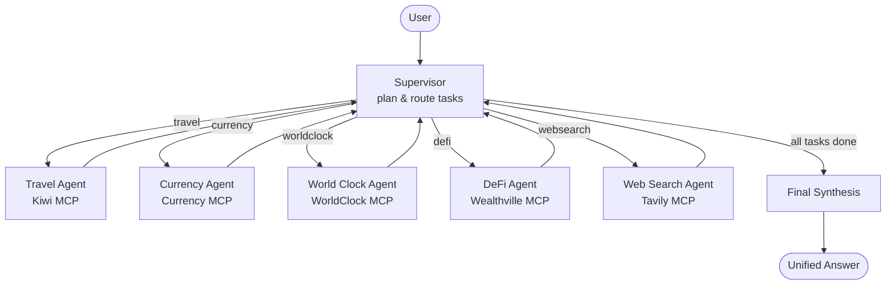

# Multi-Agent AI System — LangGraph + MCP

A production-style multi-agent AI platform built with **LangChain v1**, **LangGraph**, and the **Model Context Protocol (MCP)**. A supervisor agent plans and decomposes user requests, routes sub-tasks to five domain specialist agents backed by live MCP servers, and synthesizes their results into a single answer — with bounded retries, domain guardrails, and a middleware layer that gives every agent call limits, model and tool retries with fallback, and context trimming, plus conversation summarization, PII masking, and prompt-injection defense where needed.

Also included are two focused assistants: a **Travel Assistant** (Kiwi MCP) and a **Chinook Database Assistant** that connects to an **API-key-authenticated MCP server**. All three can be used from the terminal or from a **Streamlit web UI** with in-app client and model selection.

## Highlights

- **Supervisor–specialist orchestration (LangGraph):** a planner decomposes each request into typed sub-tasks using structured output (Pydantic schemas), executes them through specialist agents, and loops back until the queue is drained.
- **Five live MCP integrations:** Travel (Kiwi), Currency, World Clock, DeFi (Wealthville), and Web Search (Tavily) — all consumed via `langchain-mcp-adapters` over streamable HTTP.
- **Authenticated MCP access:** the Chinook agent sends an API key as a Bearer token to a protected remote MCP server, with explicit 401/HTTP error handling.
- **Custom agent middleware:**
  - A shared **reliability stack** on every agent: model/tool call limits, model retry with fallback, tool retry, tool error handling, context trimming and tool audit logging.
  - Conversation **summarization** (triggers at 50 messages, keeps the latest 10, domain-specific summary prompts).
  - **PII masking** of email addresses and phone numbers in model output and tool results.
  - A **prompt-injection guard** (`@before_agent` hook) that rejects instruction-override attempts and ends the run without calling the model.
- **Resilience by design:** two retry levels. Middleware retries individual model and tool calls inside each agent, and the workflow gives each task up to 3 attempts. Failed tasks are reported honestly in the final answer, never invented.
- **Domain guardrails:** out-of-scope requests are rejected at the planning stage without invoking any specialist.
- **Streamlit web UI:** switch between the Chinook, Travel, and Multi-Agent Workflow clients and pick the OpenAI model from the sidebar; each client keeps its own conversation, and the tool calls behind every answer can be inspected.
- **Observability:** structured logging with optional rotating file output, per-tool audit logs (name, duration, outcome), plus optional LangSmith tracing.

## Architecture



**How a request flows**

1. **Plan** — the supervisor extracts the latest user request (using prior turns only to resolve references like *"convert its price"*), and produces a validated task list via structured output. Unsupported requests are rejected immediately.
2. **Execute** — each pending task is routed to its specialist agent, which calls live MCP tools. Inside the agent, middleware retries transient model and tool errors and turns persistent tool errors into messages the agent can report. If the task still fails, the supervisor retries it, up to 3 attempts, then marks it failed with the error preserved.
3. **Synthesize** — a final node combines all successful results into one coherent response, clearly flagging anything that could not be completed.

**Standalone clients** (single-agent, independent of the workflow):

```text
clients/travel_client.py   -> Travel agent   -> Kiwi MCP server
clients/chinook_client.py  -> Chinook agent  -> API-key-protected Chinook MCP server
clients/coordinate.py      -> Plan-and-execute coordinator with concurrent task execution
```

**Web UI** (`ui/`): a Streamlit app that runs the Chinook, Travel, or full workflow client in the browser. All agents run on one background event loop, and each `(client, model)` pair is built once and then reused.

## Project Structure

```text
.
├── agents/                  # Specialist agents + MCP tool wiring
│   ├── travel_agent.py      #   Kiwi MCP (flights, itineraries)
│   ├── currency_agent.py    #   Exchange rates & conversions
│   ├── worldclock_agent.py  #   Time zones, DST, city time
│   ├── defi_agent.py        #   Liquidity pools, scores, signals
│   ├── websearch_agent.py   #   Tavily search / extract / crawl / map
│   └── chinook_agent.py     #   Authenticated Chinook DB agent (adds PII masking + injection guard)
├── clients/                 # Terminal chat clients
│   ├── travel_client.py     #   Travel-only assistant
│   ├── chinook_client.py    #   Chinook-only assistant
│   └── coordinate.py        #   Non-graph coordinator (concurrent execution)
├── graph/                   # LangGraph workflow
│   ├── workflow.py          #   Supervisor, specialist nodes, retries, synthesis
│   ├── state.py             #   Shared AgentState + task queue schema
│   └── models.py            #   Pydantic planning schemas & routing map
├── middleware/              # Shared reliability stack, summarization, PII masking, injection guard
├── prompts/                 # System & summarization prompts per domain
├── ui/                      # Streamlit web UI
│   ├── app.py               #   Page layout, client/model pickers, per-client chat history
│   ├── chat_service.py      #   Client registry + background agent worker
│   └── message_renderer.py  #   Markdown and tool-activity rendering
├── utils/                   # Shared message helpers (text extraction, final answer)
├── config.py                # Default/fallback model, UI model list, settings via pydantic-settings
├── logging_config.py        # Console + optional rotating-file logging
├── main.py                  # Multi-agent workflow chat (entry point)
└── pyproject.toml           # Dependencies (managed with uv)
```

## Tech Stack

| Layer | Technology |
| --- | --- |
| Orchestration | LangGraph (supervisor pattern, conditional routing) |
| Agent framework | LangChain v1 (`create_agent`, agent middleware) |
| Tool integration | MCP via `langchain-mcp-adapters` (streamable HTTP) |
| LLM | OpenAI (`gpt-4o-mini` by default, configurable) |
| Planning schemas | Pydantic structured output |
| Web search | Tavily MCP |
| Web UI | Streamlit |
| Observability | Python logging + optional LangSmith tracing |
| Tooling | Python 3.13+, uv |

## Getting Started

### Prerequisites

- Python **3.13+**
- [uv](https://docs.astral.sh/uv/) package manager
- An OpenAI API key

### Installation

```bash
git clone https://github.com/vignesd/multi-agent-systems.git
cd multi-agent-systems
uv sync              # core dependencies
uv sync --extra ui   # also install Streamlit for the web UI
```

### Configuration

Copy the example environment file and fill in your credentials:

```bash
cp .env.example .env        # macOS / Linux
Copy-Item .env.example .env # Windows PowerShell
```

| Variable | Required for | Description |
| --- | --- | --- |
| `OPENAI_API_KEY` | All clients | OpenAI API key for the chat model |
| `MODEL` | Optional | Default chat model (default: `gpt-4o-mini`); the UI lets you switch models per session |
| `FALLBACK_MODEL` | Optional | Backup model used when the primary model keeps failing (default: `gpt-4o`) |
| `CHINOOK_MCP_SERVER_API_KEY` | Chinook assistant (CLI or UI) | Sent as a Bearer token to the protected Chinook MCP server |
| `TAVILY_API_KEY` | Multi-agent workflow | Used by the Web Search specialist |
| `LANGSMITH_API_KEY`, `LANGSMITH_TRACING` | Optional | Enable LangSmith tracing. Set `LANGSMITH_TRACING=false` when testing with fake chat models (e.g. `GenericFakeChatModel`): the tracer uses up their scripted replies and causes misleading failures |
| `LOG_LEVEL`, `LOG_TO_FILE`, `LOG_FILE` | Optional | Logging configuration (file logging rotates at 10 MB) |

> Keep real credentials in your local `.env` only — never commit them.

## Usage

### Web UI (Streamlit)

```bash
uv sync --extra ui
uv run streamlit run ui/app.py
```

Streamlit opens the app at <http://localhost:8501>. In the sidebar:

- **Client** — choose *Chinook Customer Assistant*, *Travel Assistant*, or *Multi-Agent Workflow*. Each client keeps its own conversation for the browser session.
- **Model** — choose an OpenAI model. The list is `AVAILABLE_MODELS` in `config.py`, and your `MODEL` setting is selected by default. Switching models keeps the conversation; the new model is used from the next message on.
- **Clear this conversation** — resets the history of the selected client only.

Each answer has a **Tool activity** panel listing the MCP tool calls and results for that turn. A client's agent is built the first time you send it a message, so the first reply is slower, and credentials are checked at that point too. For example, the Chinook client reports a missing `CHINOOK_MCP_SERVER_API_KEY` in the chat instead of crashing the app.

### Terminal clients

#### Multi-agent workflow (LangGraph)

```bash
uv run python main.py
```

Initializes all five specialists, so their MCP services (including Tavily) must be reachable.

#### Travel Assistant

```bash
uv run python -m clients.travel_client
```

#### Chinook Database Assistant

```bash
uv run python -m clients.chinook_client
```

#### Coordinator (non-graph, concurrent execution)

```bash
uv run python -m clients.coordinate
```

The terminal clients are interactive chats. Type `clear` to reset the in-memory conversation, or `exit` / `quit` to end the session.

### Example prompts

**Multi-agent workflow**

- "Find a flight from Boston to Paris and convert its price to EUR."
- "What time is it in Tokyo, and what's the USD→JPY rate?"
- "Search for recent news about AI regulation in Europe."
- "Show me the top-rated DeFi liquidity pools and any recent risk signals."

**Chinook assistant**

- "Find the customer with email `luisg@embraer.com.br`."
- "Summarize the invoices for customer ID 5."

Emails and phone numbers in Chinook answers are masked (e.g. `luisg@****.br`, `****5555`) by the PII middleware; this is expected.

**Travel assistant**

- "Find flights from Boston to Paris next month."

## Middleware & Safety

Middleware is defined in `middleware/agent_middleware.py` in two layers:

- **Shared reliability stack** (`get_default_middleware`), attached to **every** specialist agent: travel, currency, world clock, DeFi, web search and Chinook.
- **Agent-specific extras:** summarization for Travel and Chinook; PII masking and the prompt-injection guard for Chinook.

**Shared reliability stack**, listed outermost → innermost (list order matters):

| Middleware | What it does |
| --- | --- |
| Model call limit | At most 10 model calls per turn; stops runaway reasoning/tool loops and caps cost |
| Tool call limit | At most 15 tool calls per turn; further calls are blocked, but the model can still answer |
| Model fallback | Switches to `FALLBACK_MODEL` (default `gpt-4o`) if the primary model keeps failing |
| Model retry | Retries transient OpenAI errors (timeouts, 5xx, rate limits) twice, with exponential backoff |
| Context editing | Replaces old, bulky tool results with a placeholder once the context passes ~20k tokens (keeps the latest 3) |
| Tool audit logger | Logs each tool call's name, duration and outcome; arguments are not logged, to avoid leaking PII |
| Tool error handling | Turns a failed tool call into an error message the model can report, instead of crashing the run |
| Tool retry | Retries transient MCP failures twice before handing the error to the handler above |

**Agent-specific middleware:**

| Middleware | What it does |
| --- | --- |
| Summarization (Travel, Chinook) | Compresses history once it reaches 50 messages, keeping the latest 10, using a domain-specific summary prompt |
| PII masking (Chinook) | Masks emails and phone numbers in assistant output and tool results; the phone pattern requires a phone-like shape, so dates and amounts are left alone |
| Prompt-injection guard (Chinook) | A `before_agent` hook that rejects common instruction-override patterns (e.g. *"ignore previous instructions"*, *"reveal your system prompt"*) and ends the run before the model is called |
| Domain guardrails | The workflow planner rejects out-of-scope requests at planning time, before any specialist or tool is invoked |

> The injection guard is a pattern-based first line of defense, not a complete security boundary — scope enforcement is reinforced in each agent's system prompt.

## Roadmap

- Automated test suite with `pytest` / `pytest-asyncio`
- Persistent conversation memory across sessions
- Checkpointing and human-in-the-loop interrupts in the LangGraph workflow
- Streaming responses in the web UI
- Containerized deployment

## License

This project is licensed under the [MIT License](LICENSE).
